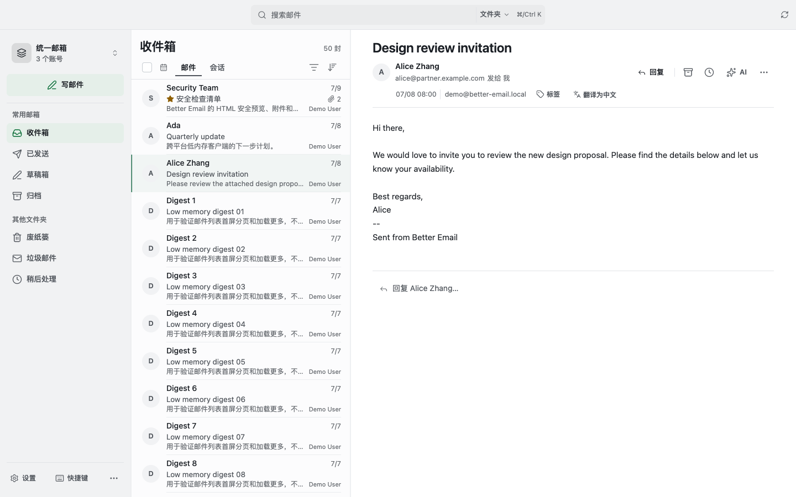
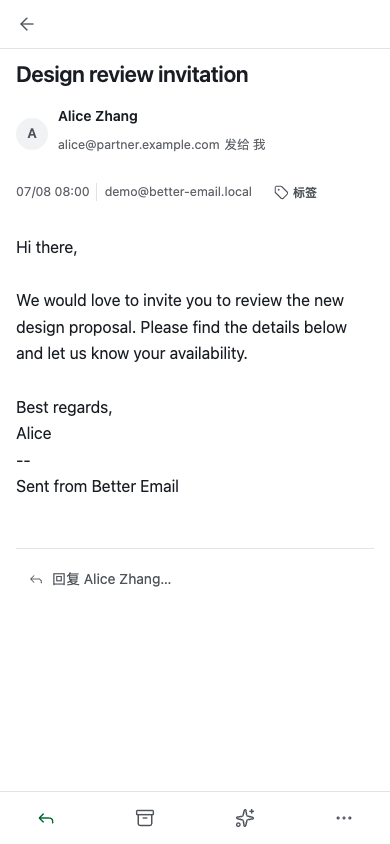

<p align="center">
  
</p>

<h1 align="center">Better Email</h1>

<p align="center"><strong>多个邮箱，一个专注的工作区。</strong></p>

<p align="center">
  本地优先的多账户邮件客户端。<br />
  让收件、阅读和写信，回到清晰而专注的节奏。
</p>

<p align="center">
  <a href="https://github.com/anYuJia/better-email/releases/latest"><strong>下载安装</strong></a>
  &nbsp;·&nbsp; <a href="#开始使用">开始使用</a>
  &nbsp;·&nbsp; <a href="#本地开发">本地开发</a>
  &nbsp;·&nbsp; <a href="./CHANGELOG.md">更新日志</a>
</p>

<p align="center"><sub>macOS · Windows · Android<br />IMAP · POP3 · SMTP · MIT</sub></p>

<p align="center">
  
  <br /><sub>桌面工作区 · 使用演示数据</sub>
</p>

Better Email 将多个邮箱带入同一个工作区，让你快速搜索、阅读和回复，同时看清当前操作属于哪个账号。邮件由你的服务商收发；AI 和外部工具可以按需配置。

<details>
<summary>查看移动端阅读界面</summary>
<br />

<br /><sub>移动端阅读界面 · 使用演示数据</sub>
</details>

## 功能一览

- **管理多个邮箱**：统一收件箱、单账号视图、文件夹、会话、标签和星标。
- **快速处理邮件**：搜索、筛选、快捷键、批量操作、规则和稍后处理。
- **阅读与写信**：富文本、附件、内嵌图片、草稿、模板、回复和快速回复。
- **掌握发送状态**：定时发送、发件箱队列、发送进度、撤销发送和失败处理。
- **整理工作资料**：联系人、VIP、别名、联系人导入、本地备份和恢复。
- **按需扩展**：连接自己配置的 AI 服务或 MCP 工具，普通邮件功能无需启用 AI。

## 下载与安装

从 [GitHub Releases](https://github.com/anYuJia/better-email/releases/latest) 下载最新正式版本：

| 平台 | 架构 | 选择的文件 |
| --- | --- | --- |
| macOS | Apple Silicon | `.dmg` |
| Windows | x64 | `.msi` |
| Android | ARM64 | `.apk` |

Android 的 `.aab` 面向应用分发；`.app.tar.gz`、`.sig` 和 `latest.json` 用于更新或发布流程。当前没有正式的 Linux 或 iOS 安装包。

> README 描述当前仓库代码；正式安装包可能尚未包含最新提交，请以 [Release](https://github.com/anYuJia/better-email/releases) 和 [更新日志](./CHANGELOG.md) 为准。

## 开始使用

1. 安装并打开 Better Email，选择添加邮箱账号。
2. 选择服务商，或手动填写收件服务器（IMAP / POP3）和 SMTP 发件服务器。
3. 按服务商要求完成 OAuth2 授权，或输入客户端授权码 / 应用专用密码。
4. 在账号设置中验证连接。验证会检查登录，不会发送邮件；完成后同步邮箱。
5. 首次使用时，可以给自己发送一封不含敏感信息的测试邮件，并检查收件箱和已发送文件夹。

| 邮箱 | 接入提示 |
| --- | --- |
| QQ 邮箱 | 在邮箱设置中开启 IMAP / SMTP，使用客户端授权码。 |
| 网易 163 / 126 / Yeah | 开启对应邮件协议，使用客户端授权码。 |
| Gmail | 可使用 OAuth2 或服务商允许的应用专用密码。 |
| Outlook / Microsoft 365 | 可使用 OAuth2；实际权限取决于账号和组织策略。 |
| 自定义邮箱 | 按服务商提供的信息配置服务器、端口和认证方式。 |

IMAP 适合需要同步文件夹和邮件状态的场景；应用中的 POP3 只同步收件箱。协议、认证和端口是否可用，取决于邮箱服务商及组织策略。

## 发送与常见问题

**点击发送后会发生什么？**

开启撤销发送延迟时，邮件先进入发件箱，倒计时内可以撤回；倒计时结束后由后台队列处理。关闭延迟时直接开始发送。发送进度反映处理阶段或实际上传进度，服务器确认接收后才表示提交成功。

**发件箱提示 SMTP 认证失败，或 QQ 邮箱返回 535？**

邮件尚未提交。请检查发件账号是否正确、服务商是否允许 SMTP，以及客户端授权码是否有效。QQ / 网易邮箱通常需要授权码，而不是网页登录密码；账号风控或登录频率限制也可能导致拒绝。修复账号后，可将邮件退回草稿再检查和发送。

**发送结果待确认怎么办？**

连接中断时，服务器可能已经接收邮件。应用会停止自动重发；请先检查服务商的已发送文件夹或向收件人确认，再在发件箱处理结果，避免重复发送。已发送但远端副本留档失败时，留档重试不会再次发送邮件。

**为什么需要保持应用运行？**

发送队列和同步由应用处理。定时发送需要应用在到期时运行；如果应用当时未运行，请重新打开并检查发件箱和发送状态。

## 隐私与数据

| 数据或操作 | 处理方式 |
| --- | --- |
| 邮件、文件夹、索引、规则、联系人、发件箱 | 主要保存在本机 SQLite；邮件收发与同步仍会连接你的邮箱服务商。 |
| 密码、授权码、OAuth Token、已保存 AI 密钥 | 本机应用层加密存储。 |
| 本地备份 | 不包含已保存的账号凭据。 |
| 远程图片 | 默认受控，可按需允许加载。 |
| AI / MCP | 需自行配置；使用外部服务时，相关内容可能发送给该服务。 |

Better Email 不提供云端邮箱托管服务。应用层凭据加密不等同于整库或全磁盘加密，请同时保护系统账户和应用数据目录。提交 Issue 或诊断信息前，请移除邮箱地址、邮件内容、授权码和 Token 等敏感信息。

## 常用快捷键

| 快捷键 | 操作 |
| --- | --- |
| `/` 或 `Cmd/Ctrl + K` | 搜索 |
| `C` | 写邮件 |
| `J` / `K` | 下一封 / 上一封 |
| `R` / `A` | 回复 / 回复全部 |
| `F` | 转发 |
| `S` / `M` / `E` | 星标 / 已读或未读 / 归档 |
| `Delete` / `Backspace` | 移至废纸篓 |
| `Cmd/Ctrl + Z` | 撤销上一步邮件操作 |
| `?` 或 `Cmd/Ctrl + /` | 打开快捷键帮助 |

## 本地开发

技术栈：**Tauri 2 · Rust · React 18 · TypeScript · Vite · SQLite**。

准备 Node.js 22、Rust stable 和对应平台的 [Tauri 2 开发依赖](https://v2.tauri.app/start/prerequisites/)。然后运行：

```bash
git clone https://github.com/anYuJia/better-email.git
cd better-email
npm ci
npm run tauri:dev
```

`npm run tauri:dev` 启动带原生后端的桌面应用；仅运行 `npm run dev` 不会提供真实邮箱后端。构建安装包使用 `npm run tauri:build`。

### 检查与测试

```bash
npm run lint                 # TypeScript 和 ESLint
npm test                     # 前端测试
npm run build:verify         # 构建、架构、CSS 和性能预算
npm run test:services        # AI / MCP 服务契约
npm run test:ui:workflow     # 模拟后端的浏览器工作流检查
npm run test:ui:quality      # 模拟后端的布局矩阵及交互采样
cargo test --manifest-path src-tauri/Cargo.toml
cargo clippy --manifest-path src-tauri/Cargo.toml --all-targets -- -D warnings
cargo fmt --manifest-path src-tauri/Cargo.toml -- --check
```

Rust 测试包含隔离 SQLite 与本地环回协议服务：IMAP 测试验证邮件头导入和重启后读取，SMTP 测试验证提交后丢失确认时不会自动重发。这些测试使用脚本化服务，不能代替真实服务商、TLS 和原生窗口的端到端验收。

浏览器质量测试默认将结果写入 `/tmp/better-email-ui-quality/quality-report.json`。可用 `node scripts/check-interaction-budget.mjs /tmp/better-email-ui-quality/quality-report.json` 检查缓存邮件切换的 p95。该指标是模拟数据下点击到两次动画帧回调的时间，并非原生窗口或真实服务商的用户输入延迟；目前 500 ms 的宽松阈值只用于发现严重回退。CI 保存报告及截图，便于在同类运行环境中比较。

更多产品定义与设计约束见 [PRODUCT.md](./PRODUCT.md) 和 [UI/UX 规范](./docs/design/UI_UX_SPEC.md)。

## 参与项目

欢迎通过 [Issues](https://github.com/anYuJia/better-email/issues) 报告问题或提出建议。报告发送问题时，提供操作步骤、邮箱服务商和经过脱敏的错误信息，有助于定位问题；请勿提交凭据或邮件正文。

感谢所有[贡献者](./CONTRIBUTORS.md)。项目采用 [MIT License](./LICENSE)。
